<p align="center"></p>

# mathra

SVG equations without a TeX install. **[Try it in the browser](https://matheusmota-dev-br.github.io/mathra/)**. mathra reads math LaTeX, builds a **tree of meaning** (what each piece is) and draws it with **explicit rules**, numbered and tested. The locale decides the form: English by default, and in pt-BR `3,14` is a single number and `\sin` comes out as `sen`.

```console
$ mathra '3,14' --locale pt-BR --explain
input    3,14
locale   pt-BR
text     3,14
speech   3,14
tree     {"type":"row","children":[{"type":"number","value":"3.14"}]}
rules
  L-NUM-1   '3,14': comma between digits read as decimal separator (3.14)
  L-NUM-2   3.14 written with ',' as decimal separator (pt-BR)

$ mathra 'f(1, 5) = \sin x - 2.5' -o function.svg
```

## Examples

Every image below is an SVG written by mathra; the LaTeX for each one is in [`crates/core/tests/examples.rs`](crates/core/tests/examples.rs), which also checks that the files match the code. They are shown on a white card so they read well on dark pages too.

### Famous equations

<table>
<tr><td align="center">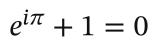<br><sub>Euler's identity</sub></td><td align="center">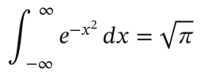<br><sub>Gaussian integral</sub></td></tr>
<tr><td align="center">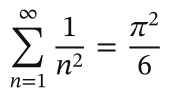<br><sub>Basel problem</sub></td><td align="center">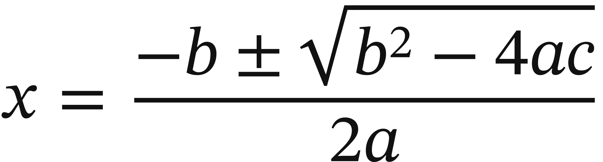<br><sub>Quadratic formula</sub></td></tr>
<tr><td align="center" colspan="2">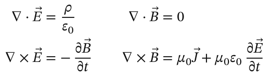<br><sub>Maxwell's equations</sub></td></tr>
<tr><td align="center" colspan="2">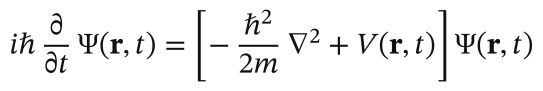<br><sub>Schrödinger equation</sub></td></tr>
<tr><td align="center">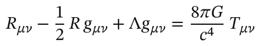<br><sub>Einstein field equations</sub></td><td align="center">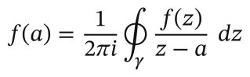<br><sub>Cauchy's integral formula</sub></td></tr>
<tr><td align="center">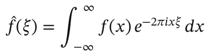<br><sub>Fourier transform</sub></td><td align="center">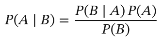<br><sub>Bayes' theorem</sub></td></tr>
</table>

### Beyond the basics

Continued fractions, matrices with dots, `cases`, binomials, labeled braces, chemistry (`\ce`), units (`\SI`), commutative diagrams, the pt-BR locale and computed long division:

<table>
<tr><td align="center">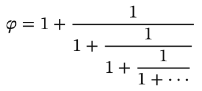<br><sub>Golden ratio as a continued fraction</sub></td><td align="center">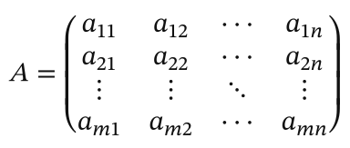<br><sub>m × n matrix with dots</sub></td></tr>
<tr><td align="center">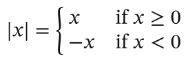<br><sub>Piecewise definition</sub></td><td align="center">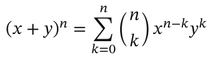<br><sub>Binomial theorem</sub></td></tr>
<tr><td align="center">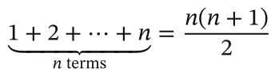<br><sub>Labeled brace</sub></td><td align="center">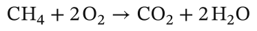<br><sub>Chemical equation (mhchem)</sub></td></tr>
<tr><td align="center">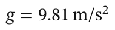<br><sub>Quantity with units (siunitx)</sub></td><td align="center">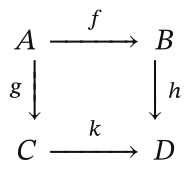<br><sub>Commutative diagram (amscd)</sub></td></tr>
<tr><td align="center">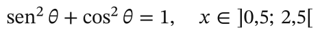<br><sub>pt-BR locale: sen, decimal comma, open interval</sub></td><td align="center">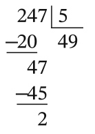<br><sub>Long division, computed (pt-BR)</sub></td></tr>
</table>

### What a screen reader hears

Each SVG carries the equation as speech in its `<title>`:

| Equation | Speech (`--speech`) |
|---|---|
| `x = \frac{-b \pm \sqrt{b^2 - 4ac}}{2a}` | x equals fraction, negative b plus or minus square root of b squared minus 4 a c, end root, over 2 a, end fraction |
| `\sum_{n=1}^{\infty} \frac{1}{n^2} = \frac{\pi^2}{6}` | sum from n equals 1 to infinity of 1 over n squared equals pi squared over 6 |
| `\lvert a \rvert + \lvert b \rvert \ge \lvert a + b \rvert` | absolute value of a plus absolute value of b is greater than or equal to absolute value of, a plus b, end absolute value |
| `\divchave{247}{5}` with `--locale pt-BR` | divisão armada de 247 por 5: quociente 49, resto 2 |

## Broken LaTeX

By default mathra draws what it can and returns **warnings** for what it had to fix (`E-REC-1` to `E-REC-9`, in `spec/tolerance.md`): unknown commands, unbalanced braces, double scripts, leftover JSON escapes such as `\n` or `\u00b2`. Warnings show up in `--explain`, on stderr, in `Output::warnings` and in the SVG's `<metadata>`. With `--strict`, mathra refuses invalid input instead, like TeX.

```console
$ mathra '\vertA\vert = C_{16,2}' --text
mathra: warning E-REC-1: column 1: unsupported command: \vertA; read as \vert A
|A| = C_(16, 2)
```

## Locales

16 languages: `en` (default), `pt-BR`, `es`, `fr`, `de`, `it`, `ru`, `zh`, `ja`, `ko`, `hi`, `ar`, `id`, `tr`, `nl` and `pl`, with `--locale` (or `locale="fr"` in Python and JavaScript). The locale changes how the equation is read, written and spoken: in pt-BR `3,14` is one number with a decimal comma, `1.000` is one thousand, `\sin` is written `sen` and `]a, b[` is an open interval; in fr `\frac{3}{4}` is spoken "trois quarts"; in zh `\frac{1}{2}` is "2 分之 1". Each language is a JSON file in `crates/core/src/locales/`, described in [`spec/locales.md`](spec/locales.md) with how to add one. English and pt-BR are reviewed; the other languages still need a native speaker's review of the speech. Every rule that depends on the locale is numbered in `spec/rules.md`.

## What the SVG carries

Besides the outlines, every SVG follows the contract in `spec/svg.md`: speech for screen readers, the source equation and the tree in `<metadata>`, color inherited from the page, reused glyphs, a text layer for selection and unique ids per equation. The same input always produces the same bytes.

## Usage

**Terminal**

```console
$ cargo install mathra-cli
$ mathra 'x \le 2.75; y \ge 1' -o inequality.svg
$ mathra '3,14 + \sin x' --locale pt-BR
$ mathra 'x = -1' --speech        # x equals negative 1
$ echo 'a + b' | mathra --tree
```

**Python** (`crates/python`, with [maturin](https://www.maturin.rs))

```python
import mathra

svg = mathra.tex_to_svg(r"\sin x = 0.5")              # <title>…sine of x equals 0.5</title>
tree = mathra.tex_to_tree("3,14", locale="pt-BR")      # JSON
```

**JavaScript** (`crates/wasm`; the `.wasm` builds with `cargo build -p mathra-wasm --release --target wasm32-unknown-unknown`, packaging with wasm-pack is still to do)

```js
import { texToSvg, render } from "mathra";
const svg = texToSvg("3.14");
const pt = texToSvg("3,14", "pt-BR");
const all = JSON.parse(render("x^2"));   // svg, speech, text, tree, applied, warnings
```

**Rust** (`cargo add mathra`)

```rust
let r = mathra::convert("3.14", &mathra::Options::default())?;
println!("{}", r.svg);
```

## What it converts

Layout follows the parameters of the embedded font's MATH table.

- Fractions (`\frac`, `\dfrac`, `\tfrac`, `\cfrac`, `\over`), binomials, roots with an index
- Scripts, primes (`f'`), limits (`\lim`, `\sum`, `\prod`, `\int` and family, `\limits`)
- `\left … \middle … \right`, `\big` and family, delimiters assembled from parts
- Matrices (`matrix`, `pmatrix`, `bmatrix`, `Bmatrix`, `vmatrix`, `Vmatrix`, `smallmatrix`), `cases`, `aligned`, `align`, `gathered`, `split`, `array` with `|`, `@{}`, `\hline`, `\cline`
- Accents (`\hat`, `\vec`, `\bar`, `\dot`, `\widehat`, `\overrightarrow`…), `\overline`, `\underline`, `\overbrace`/`\underbrace` with labels, `\xrightarrow` and family, `\overset`, `\underset`, `\stackrel`
- `\text` with `$…$` and old-style accents (`\'e`, `\c{c}`), alphabets (`\mathbb`, `\mathcal`, `\mathfrak`, `\mathbf`, `\boldsymbol`, `\mathsf`, `\mathtt`), old `\bf`/`\rm`/`\tt`
- `\cancel`, `\boxed`, `\textcircled`, `\color`, `\phantom`, `\pmod`, `\operatorname`, spaces (`\,` `\quad` `\hspace`)
- siunitx (`\SI`, `\qty`, `\si`, `\num`, `\ang`), basic `\ce`, HTML entities coming from editors
- Substitution macros: `\newcommand`, `\renewcommand`, `\def`, `\let`, `\DeclareMathOperator`, `\DeclarePairedDelimiter`, `\newenvironment`
- Packages: physics (`\dv`, `\pdv`), braket (`\ket`, `\braket`, `\Set`), xfrac, units, `\genfrac`, `\substack`, `\sideset`, `\smash`, `\mathclap`, `\multicolumn`, `\intertext`, `\hdotsfor`, `\raisebox`, `\scalebox`, `\rule`, `\verb`; old syntax `\cases`, `\matrix`, `\eqalign`
- amscd commutative diagrams (`\begin{CD}`)
- mathra extensions: `\divchave{247}{5}` (long division, Brazilian layout) and `\contaarmada{+}{347}{285}` (column arithmetic), both computed

Out of scope, by the rule in `spec/boundary.md` (mathra is for equations): TikZ, `tikz-cd`, `xymatrix`, `\chemfig` and TeX programming (`\ifx`, `\catcode`). Not yet: automatic line breaking, MathML and PNG output, full `\ce`.

## Benchmark

`corpus/` holds 116 hand-written constructions, one or a few per command family and package. One run of `cargo run --release -p mathra --example bench` (arm64, Apple M5, rustc 1.99.1):

| Measure | Value |
|---|---|
| Constructions | 116 |
| Strict: converted | 109 (94.0%) |
| Tolerant: no warning | 109 (94.0%) |
| Tolerant: with warnings | 7 (6.0%) |
| Tolerant: error | 0 (0.0%) |
| Time per equation, mean | 18.7 µs |
| Time per equation, p95 | 46.9 µs |

Times vary by a few microseconds between runs. The 7 that strict mode refuses are not equations: TeX programming (`\ifx`, `\expandafter`, `\catcode`) and diagrams (`tikz-cd`, `xymatrix`, `\tikz`, `\chemfig`). Tolerant mode draws them as text with a warning.

### Compared with KaTeX and MathJax

`bench/compare.mjs` runs the three libraries on the same equations in Node (`cd bench && npm install && npm run compare`; Node 24, Apple M5, katex 0.16.22, mathjax-full 3.2.2). "Clean" means no error and no command drawn in red. The [playground](https://matheusmota-dev-br.github.io/mathra/#benchmark) runs the same comparison in your browser.

| | mathra (wasm) | MathJax (SVG) | KaTeX (HTML) |
|---|---|---|---|
| Gallery, 18 equations: clean | 18 | 15 | 15 |
| Gallery: time per equation, mean | 114 µs | 631 µs | 76 µs |
| Corpus, 116 constructions: clean | 109 | 70 | 62 |
| Output per equation, gzip | 2.32 KB | 2.43 KB | 0.95 KB + CSS and fonts |
| Download to render in a browser, gzip | 926 KB | 660 KB | 77 KB + up to 254 KB of fonts |

KaTeX is faster and lighter to ship, but its output is HTML that needs its stylesheet and fonts, not a standalone image. Against MathJax's SVG, the closest equivalent, mathra is about 5× faster with output of similar size. Most of mathra's download is the embedded font (628 KB gzip). The corpus was written while building mathra, so it favors it; the three gallery equations the others miss use `\SI`, `\sen` and `\divchave`.

## Layout

```
crates/core      tree, rules, layout, embedded font, outputs (SVG, speech, text)
crates/core/examples  bench (the benchmark above) and banner (the image above)
crates/cli       `mathra` binary
crates/python    Python module (PyO3 + maturin)
crates/wasm      JavaScript module (wasm-bindgen)
spec/            numbered rules (rules.md) and the SVG contract (svg.md)
corpus/          hand-written constructions used by the benchmark
docs/examples/   the README gallery, generated by tests/examples.rs
```

## Development

```console
$ cargo test                 # one test per rule, with the rule id in its name
$ cargo clippy --all-targets
$ cargo run -p mathra-cli -- '3,14' --locale pt-BR --explain
```

To change behavior, write the rule in `spec/`, cite its id in the code and add a test with the same id.

The tests cover 100% of the lines of the core, the CLI and the Python module. [docs/tests.md](docs/tests.md) explains how to run each suite (including wasm on Node and pytest), what each file checks, the coverage per file and the problem inputs already tested.

The banner above is drawn by mathra itself (`cargo run -p mathra --example banner`); `tests/banner.rs` fails if it goes stale.

## Licenses

Code: your choice of [MIT](LICENSE-MIT) or [Apache-2.0](LICENSE-APACHE), as is common in the Rust ecosystem. Embedded font: STIX Two Math, SIL Open Font License 1.1 (`crates/core/fonts/OFL-STIXTwoMath.txt`).
